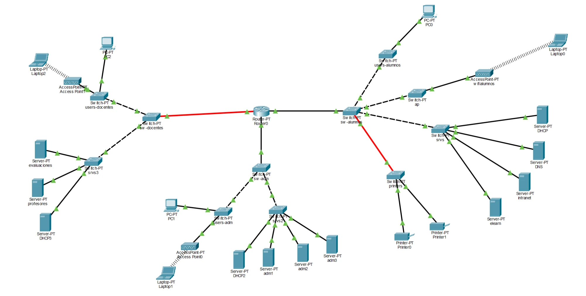
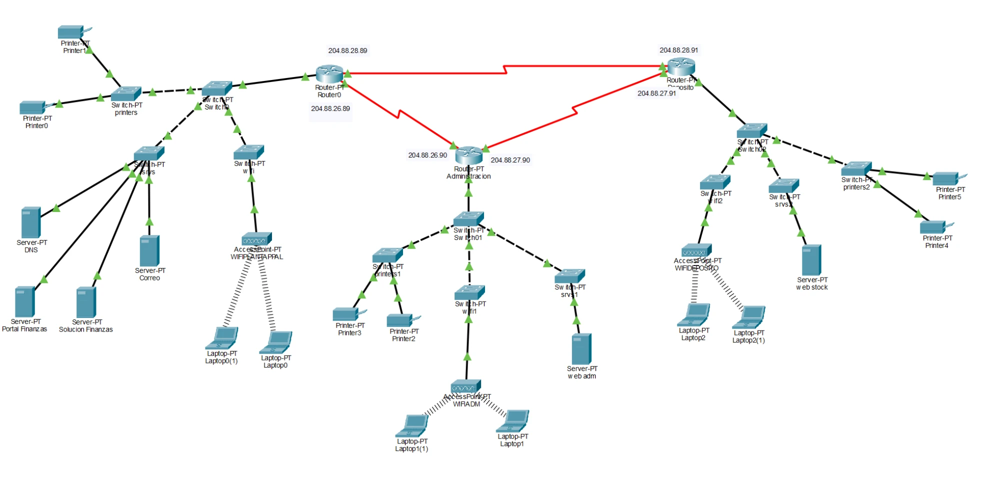
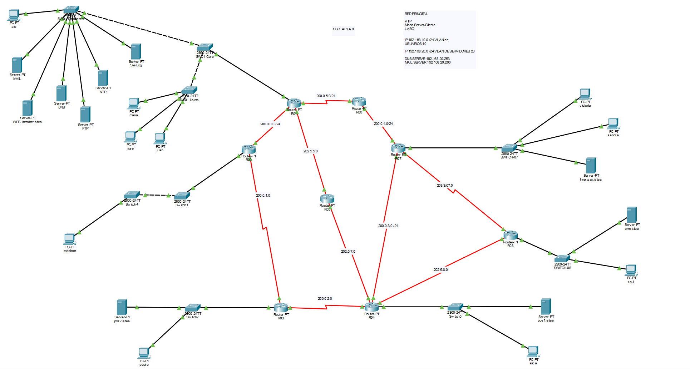

Packet Tracer es el programa con el que hacíamos los trabajos prácticos de redes en ISTEA. Lo publica Cisco, es gratuito y permite armar una red completa, con routers, switches, servidores, PC, impresoras y Wi-Fi, sin comprar un solo equipo.

En corto:

- Es **gratis**, pero para descargarlo hay que crear una cuenta en Cisco Networking Academy (NetAcad) e inscribirse en un curso corto, también gratuito.
- La versión actual es la **9.0.1**, para Windows, macOS y Ubuntu de 64 bits.
- La primera vez que lo abrís, pide iniciar sesión con esa cuenta.
- Alcanza para practicar buena parte de lo que piden el CCST Networking y el CCNA: VLAN, rutas estáticas, OSPF, NAT y DHCP.

## Qué es Packet Tracer

Cisco lo presenta como una herramienta de simulación y visualización de redes: un laboratorio virtual para practicar redes, IoT y ciberseguridad sin hardware. En la práctica, arrastrás los equipos a un área de trabajo, los conectás con cables y los configurás como si fueran reales. Los routers y switches de Cisco se configuran por línea de comandos, con los comandos de IOS, el sistema de esos equipos.

También es la herramienta que usan los cursos de NetAcad para sus actividades prácticas, así que si vas a cursar la ruta de redes o la serie CCNA, lo vas a necesitar igual.

## Cómo descargarlo gratis

Cisco lo distribuye a través de NetAcad. Los pasos son tres:

1. **Iniciá sesión o creá una cuenta** en [netacad.com](https://www.netacad.com/). Es gratis.
2. **Inscribite en el curso *Getting Started with Cisco Packet Tracer*.** Es gratuito, a tu ritmo, dura unas 2 horas y está disponible en español.
3. **Descargá el instalador** desde el material del curso, donde está la versión más reciente.

Con la sesión iniciada, la descarga también aparece en el centro de recursos de NetAcad, donde se elige el instalador según el sistema operativo.

Después de instalarlo, la primera vez que lo abrís pide autenticarte: hay que hacer clic en el botón verde **Skills For All** e iniciar sesión con la misma cuenta. La descarga oficial está en NetAcad; un instalador bajado de otro sitio no tiene esa garantía.

## Qué necesita tu computadora

| Requisito | Detalle |
| --- | --- |
| Sistema operativo | Windows 11, macOS 12 o posterior, o Ubuntu 22.04 o 24.04 LTS |
| Procesador | 64 bits, amd64 (x86-64) |
| Memoria | 4 GB de RAM libres |
| Disco | 1,4 GB libres |

## Lo que armábamos en la cursada

A lo largo de la cursada simulamos tanto una empresa con sectores como redes con varias sedes. Estas son tres topologías que armé para esos trabajos, de la más simple a la más completa.

*Una sola sede con un router y tres sectores (docentes, alumnos y administración), cada uno con sus switches, servidores, impresoras y Wi-Fi.*

*Tres sedes (planta principal, administración y depósito) conectadas entre sí por sus routers, cada una con servidores, impresoras y puntos de acceso Wi-Fi.*

*La más completa: una red principal con una VLAN de usuarios y otra de servidores (DNS, correo, web, FTP, NTP y registros), VTP entre los switches y ocho routers con OSPF en el área 0.*

Ese recorrido, de una sede a varias y de una red plana a VLAN y enrutamiento dinámico, es el mismo que propongo en la sección [CCNA desde cero](/redes/curso-ccna-como-prepararte/#ccna-desde-cero).

## Qué practicar primero

No hace falta arrancar con una topología grande. Dos ejercicios cortos ya cubren lo central:

- **Dos redes y dos routers.** La guía de [fundamentos de redes](/redes/fundamentos-de-redes-para-certificarte/) tiene un primer ejercicio: dos subredes, rutas estáticas para que se hagan ping y después OSPF en lugar de las rutas fijas.
- **VLAN y enrutamiento entre VLAN.** La sección [CCNA desde cero](/redes/curso-ccna-como-prepararte/#ccna-desde-cero) lo arma paso a paso, con los errores más comunes y los comandos para revisarlos.

Guardá cada topología como archivo (.pkt). Volver a una red que ya funcionaba y romperla a propósito es una buena forma de practicar la resolución de problemas.

## Consejos para tus primeras topologías

- **Probá cada tramo antes de seguir.** Cada vez que sumes un equipo o una red, mandá un ping. Se puede hacer desde la PC, en **Desktop > Command Prompt**, o con la herramienta **Add Simple PDU**, el sobre cerrado de la barra: un clic en el equipo de origen y otro en el de destino. Si armás todo de una y recién ahí probás, encontrar dónde falla es mucho más difícil.
- **Usá el modo Simulation.** Yo lo usaba mucho. Abajo a la derecha se pasa de **Realtime** a **Simulation**, y ahí el paquete avanza paso a paso: se ve por qué equipo pasa y en cuál se pierde. Con **Edit Filters** podés dejar a la vista solo el protocolo que te interesa, por ejemplo ICMP para seguir un ping.
- **Configurá los servidores desde la pestaña Services.** Los servidores de Packet Tracer traen servicios listos para activar, como DHCP, DNS, HTTP, correo, FTP, NTP y Syslog. Así se armaron los de la red principal de arriba. Antes de activarlos, dale al servidor una IP fija en **Desktop > IP Configuration**.
- **Anotá el direccionamiento en el área de trabajo.** Una nota con cada red, cada VLAN y la IP de los servidores, como la de la última captura, te evita volver a revisar equipo por equipo.

## Para qué certificaciones sirve

- **CCST Networking:** el [examen 100-150](/redes/ccst-networking-examen/) incluye configurar y verificar conexiones, algo que se practica mejor armando la red que leyendo.
- **CCNA:** el examen incluye preguntas basadas en desempeño, donde hay que configurar, no elegir definiciones. Las rutas para prepararlo están en la guía de [curso CCNA](/redes/curso-ccna-como-prepararte/).
- **Cursos de NetAcad:** Introducción a las redes, el primero de la serie [CCNA 1, 2 y 3](/redes/ccna-1-2-3-cursos-netacad/), tiene una evaluación práctica y una final hechas en Packet Tracer.

## Fuentes

- [Getting Started with Cisco Packet Tracer (Cisco Networking Academy)](https://www.netacad.com/courses/getting-started-cisco-packet-tracer): qué es Packet Tracer, cómo se descarga, duración del curso e idiomas.
- [Centro de recursos de Cisco Networking Academy](https://www.netacad.com/resources/lab-downloads): versión 9.0.1, sistemas operativos, requisitos e inicio de sesión.
- [Introducción a las redes (Cisco Networking Academy)](https://www.netacad.com/courses/ccna-introduction-networks): las evaluaciones en Packet Tracer del curso.

*Versión, requisitos y pasos de descarga verificados el 10 de noviembre de 2026 en Cisco Networking Academy.*
